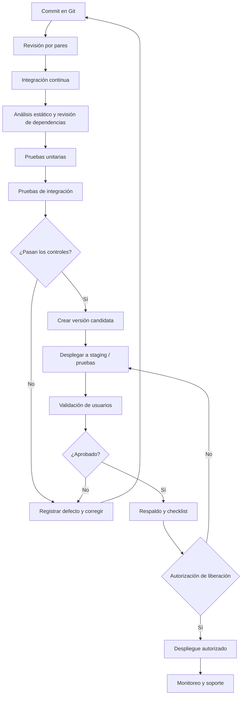

# Diagrama 3. Pipeline CI/CD propuesto

La publicación en producción solo se realiza si existe autorización institucional y un ambiente real disponible. Para una entrega académica puede demostrarse hasta staging.
